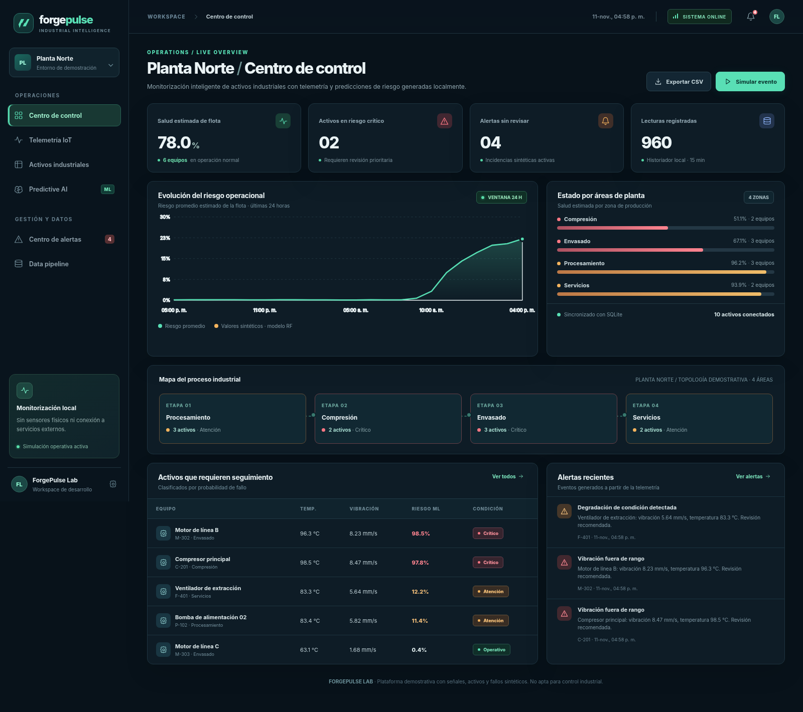
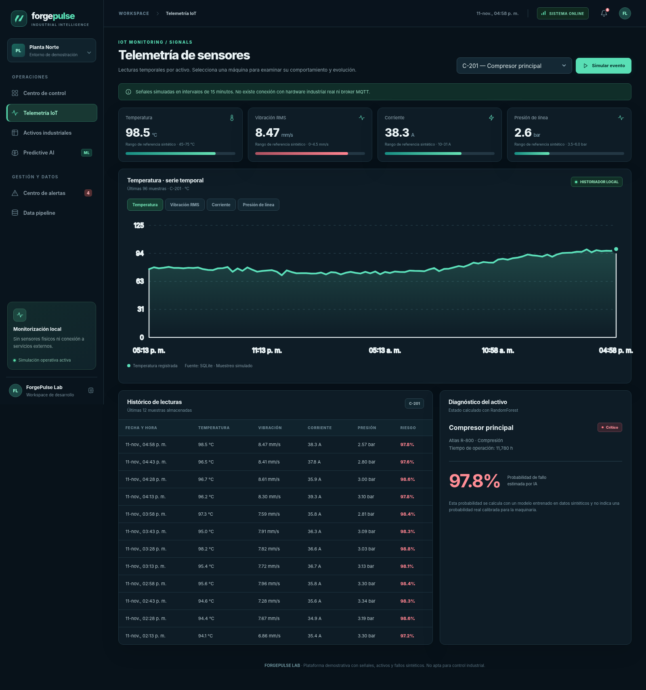
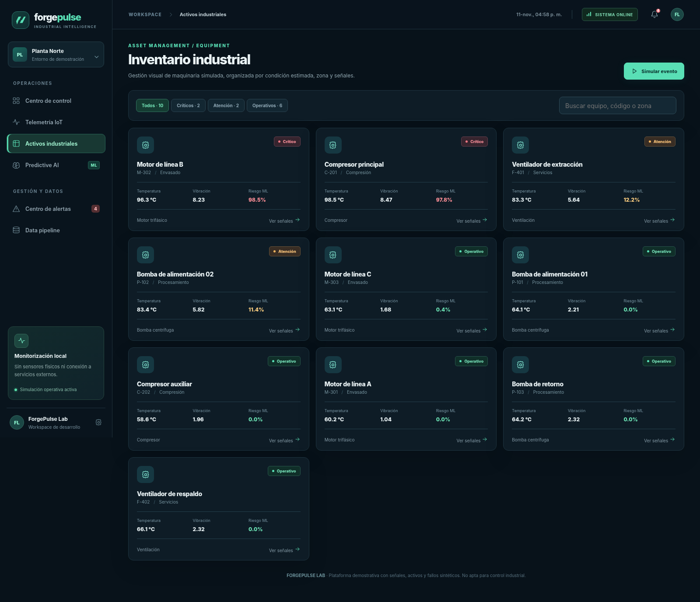
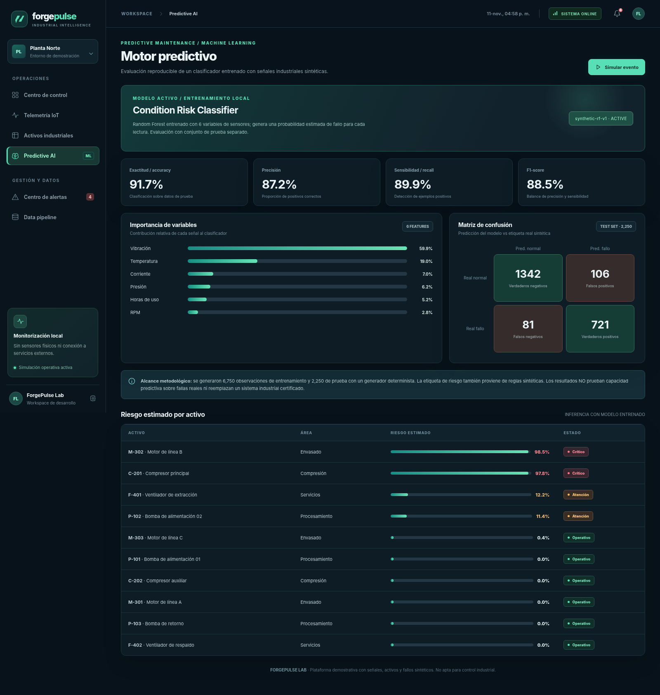
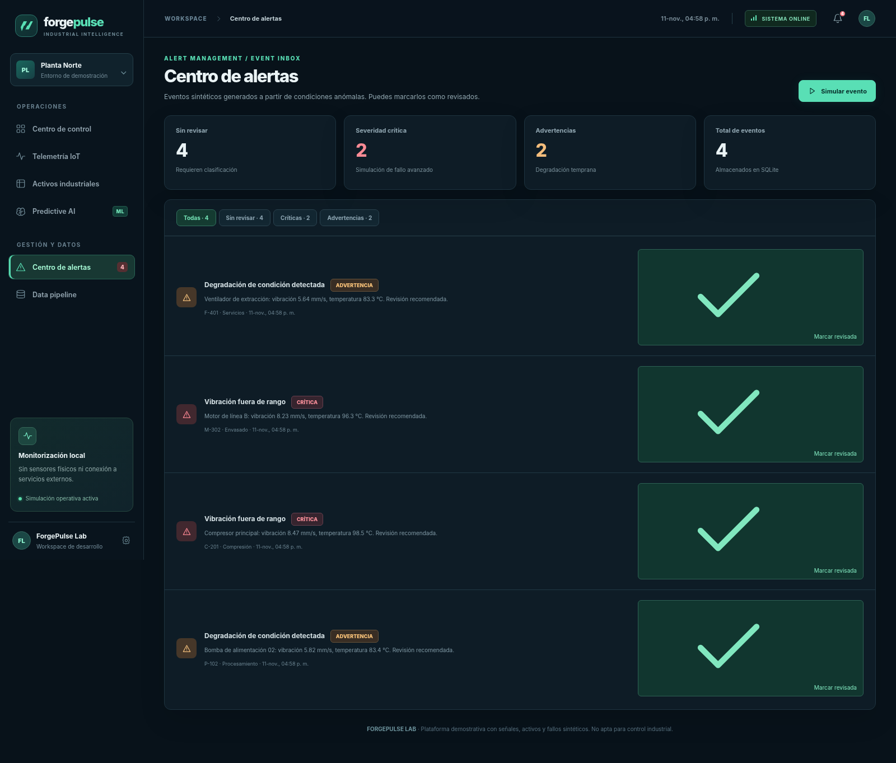
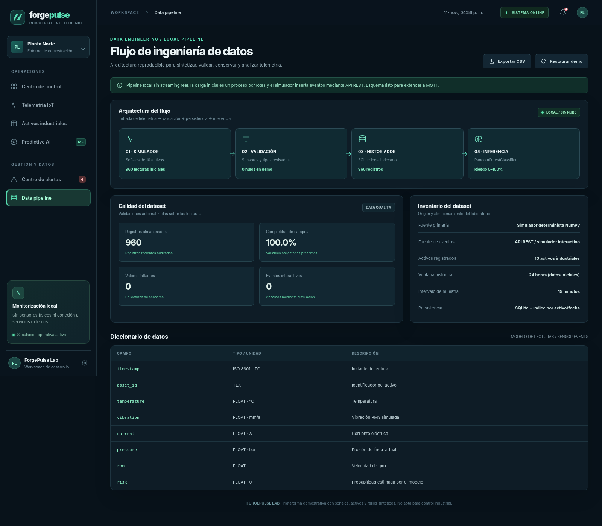
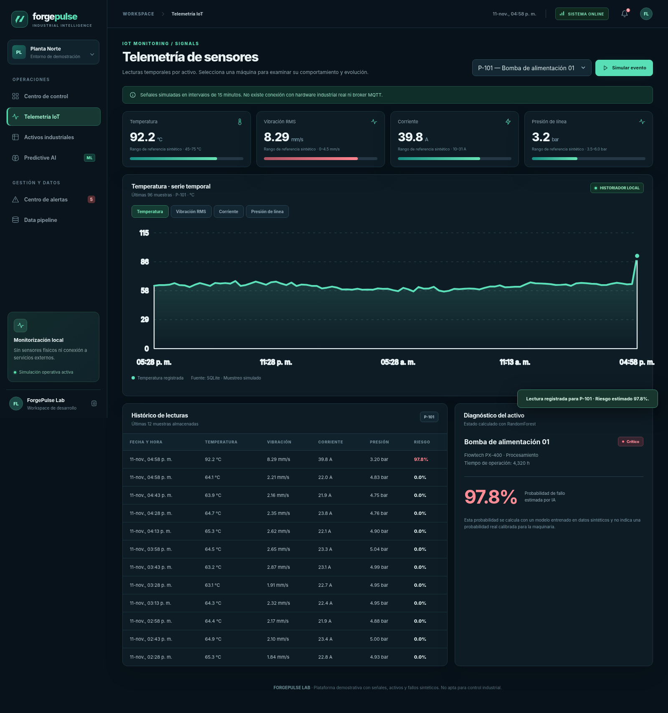
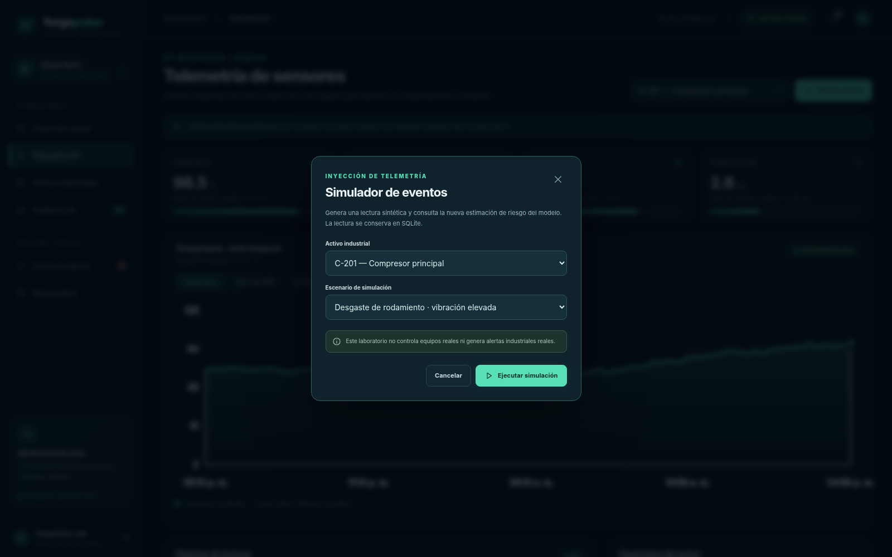
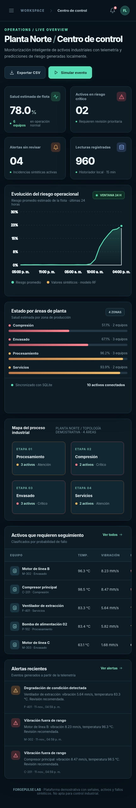
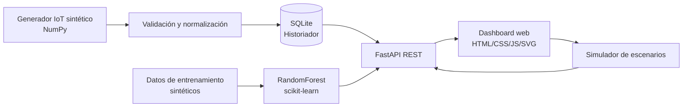

# ForgePulse — Industrial Intelligence

**Industrial IoT · Predictive Maintenance · Machine Learning · Data Engineering**



**ForgePulse** es un laboratorio de ingeniería de software que combina telemetría industrial simulada, análisis de condición, un modelo supervisado de *Machine Learning* y una interfaz web estilo centro de operaciones. Ayuda a explorar cómo priorizar el mantenimiento de bombas, compresores, motores y ventiladores cuando una planta produce series temporales de sensores.

> **Alcance:** laboratorio de simulación industrial ejecutable localmente. Los equipos, sensores, lecturas, incidentes, etiquetas de entrenamiento y probabilidades son **sintéticos**. No es un SCADA certificado, no controla maquinaria ni predice fallas reales de equipos industriales.

## Vista rápida

| Centro de control | Telemetría por activo |
|---|---|
|  |  |
| **Inventario y condición** | **Clasificador predictivo** |
|  |  |
| **Gestión de alertas** | **Pipeline de datos** |
|  |  |

<details>
<summary><strong>Más capturas: simulador interactivo y responsive</strong></summary>

**Escenario de desgaste ejecutado:**



**Modal para inyectar lecturas sintéticas:**



**Vista móvil:**



</details>

## Funciones implementadas

| Área | Capacidades reales del prototipo |
|---|---|
| **Centro de control** | KPIs, riesgos de 10 activos, evolución de la flota, zonas de planta, eventos abiertos |
| **Sensores IoT simulados** | 960 muestras iniciales de temperatura (°C), vibración (mm/s), corriente (A), presión de línea (bar), RPM y horas de uso |
| **Machine Learning** | Entrenamiento reproducible de `RandomForestClassifier`, conjunto train/test, matriz de confusión, F1, precisión, recall, AUC e inferencias con `predict_proba` |
| **Equipos industriales** | Inventario por tipo y zona, estado calculado, ficha del equipo y series temporales |
| **Simulador interactivo** | Casos normales, desgaste de rodamiento, sobrecalentamiento y pérdida de presión; inserta nuevas lecturas por API |
| **Alertas** | Eventos de riesgo, niveles de gravedad, historial y marcado de eventos revisados |
| **Data engineering** | Generación determinista, validación básica, índice SQL por equipo/fecha, historial, exportación CSV y restablecimiento de demo |
| **Interfaz web** | 6 secciones navegables, gráficos SVG, búsqueda y filtros, diseño adaptable, sin CDN ni servicios externos |

### Tecnologías

`Python` · `FastAPI` · `scikit-learn` · `NumPy` · `SQLite` · `REST` · `HTML5` · `CSS3` · `JavaScript` · `SVG` · `Pytest` · `GitHub Actions`

## Arquitectura



- **Backend:** `src/forgepulse/api.py`, `storage.py`, `simulator.py` y `modeling.py`.
- **ML:** se entrena desde cero con una semilla fija; el modelo y la ficha de métricas están en `model/`.
- **Persistencia:** la base `data/forgepulse.sqlite3` se crea al primer arranque y está excluida de Git.
- **Frontend:** `web/` sirve una SPA ligera sin instalar paquetes de Node.js.
- **Evidencias:** `docs/screenshots/` contiene capturas de vistas renderizadas usando respuestas reales de la API local.

Más detalles en [Arquitectura](docs/ARCHITECTURE.md) y [Modelo y limitaciones](docs/MODEL_CARD.md).

## Ejecución local — Windows, macOS y Linux

Requiere **Python 3.10 o superior**. No requiere Node.js, Supabase, Docker, suscripciones ni dispositivos físicos.

```bash
# Clonar el repositorio
# git clone https://github.com/TU-USUARIO/ForgePulse.git
cd ForgePulse

# Crear un entorno virtual
python -m venv .venv

# Activar: Windows PowerShell
# .venv\Scripts\Activate.ps1
# Activar: macOS / Linux
source .venv/bin/activate

# Instalar dependencias
python -m pip install -e .

# Preparar el modelo y los datos de muestra (opcional; se inicializan al arrancar)
python scripts/bootstrap.py

# Iniciar la interfaz y la API
python -m uvicorn forgepulse.api:app --reload --host 127.0.0.1 --port 8000
```

Abre **http://127.0.0.1:8000**. Documentación de API: **http://127.0.0.1:8000/docs**.

> En PowerShell, usa `.venv\Scripts\Activate.ps1` en lugar de `source .venv/bin/activate`. Si `python` no está disponible, prueba `py` en Windows o `python3` en Linux/macOS.

### Demostración sugerida

1. Entra a **Centro de control** para comparar áreas y equipos críticos.
2. Selecciona **C-201** en **Telemetría IoT** y alterna temperatura, vibración y corriente.
3. Visita **Predictive AI** para ver métricas y variables importantes del clasificador.
4. Pulsa **Simular evento** y selecciona un activo con el escenario `Desgaste de rodamiento`.
5. Regresa al centro de control para ver el nuevo riesgo; en **Centro de alertas**, marca el evento como revisado.
6. Descarga los datos con **Exportar CSV** y, cuando lo desees, utiliza **Restaurar demo** desde Data pipeline.

El primer arranque genera aproximadamente 24 horas de historial a intervalos de 15 minutos. No existe actualización automática continua de sensores: las nuevas lecturas se generan mediante el simulador de eventos.

## API REST

| Método | Ruta | Función |
|---|---|---|
| `GET` | `/api/health` | Disponibilidad de la API |
| `GET` | `/api/overview` | Estado, indicadores, tendencias y riesgos por zona |
| `GET` | `/api/assets` | Lista de equipos y condición actual |
| `GET` | `/api/assets/{asset_id}` | Equipo, lecturas y alertas |
| `GET` | `/api/model` | Evaluación, variables y matriz de confusión |
| `GET` | `/api/alerts` | Bandeja de eventos |
| `POST` | `/api/alerts/{id}/acknowledge` | Marcar alerta revisada |
| `POST` | `/api/simulate` | Generar una nueva lectura sintética |
| `GET` | `/api/pipeline` | Estadísticas de calidad y esquema |
| `GET` | `/api/export.csv` | Exportar telemetría |
| `POST` | `/api/demo/reset` | Regenerar datos de demostración |

Ejemplo para generar una lectura:

```bash
curl -X POST http://127.0.0.1:8000/api/simulate \
  -H "Content-Type: application/json" \
  -d '{"asset_id":"M-301","scenario":"bearing"}'
```

## Cómo se entrenó el modelo

El clasificador trabaja con **6 variables**: `temperature`, `vibration`, `current`, `pressure`, `rpm` y `hours`. Se generan 9.000 observaciones artificiales y se separan en **6.750 entrenamiento / 2.250 prueba**. La etiqueta de riesgo se construye aplicando una función sintética con ruido controlado.

| Métrica en el conjunto de prueba sintético | Resultado de referencia |
|---|---:|
| Accuracy | 91,7 % |
| Precision | 87,2 % |
| Recall | 89,9 % |
| F1 | 88,5 % |
| ROC-AUC | 97,4 % |

Estas métricas son **válidas exclusivamente para el escenario de entrenamiento generado** y no constituyen evidencia de rendimiento en una planta real. El valor mostrado como *riesgo* en la UI es la salida `predict_proba` del modelo sobre esta distribución sintética, **no una probabilidad industrial calibrada**.

Para repetir el entrenamiento:

```bash
python scripts/train_model.py
```

## Pruebas y calidad

```bash
python -m pip install -r requirements-dev.txt
python -m pytest -q
```

Incluye **4 pruebas automatizadas** que verifican endpoints, almacenamiento, simulador, reconocimiento de equipos, confirmación de alertas, validación, exportación, reinicio de datos y metadatos del clasificador. El workflow en `.github/workflows/check.yml` ejecuta las pruebas en GitHub Actions después de instalar dependencias.

Además, durante el desarrollo se comprobaron seis secciones del frontend en Chromium y se ejercitaron la simulación y el marcado de alertas sin errores JavaScript. El entorno de captura utilizó un puente local para consultar la API durante el renderizado del frontend.

## Estructura del repositorio

```text
ForgePulse/
├── src/forgepulse/
│   ├── api.py              # Rutas REST + frontend
│   ├── storage.py          # SQLite, índices, alertas y registros
│   ├── simulator.py        # Generador IoT y escenarios
│   └── modeling.py         # Entrenamiento, métricas e inferencia ML
├── web/                    # Interfaz responsive (HTML, CSS, JS, SVG)
├── model/                  # Pesos del modelo + evaluación reproducible
├── data/                   # Base SQLite local (generada al iniciar)
├── examples/               # Muestra de lecturas exportables
├── tests/                  # Pruebas API / ML
├── scripts/                # Reentrenamiento e inicialización
├── docs/
│   ├── screenshots/        # 9 imágenes de la interfaz
│   ├── ARCHITECTURE.md
│   └── MODEL_CARD.md
├── .github/workflows/      # Integración continua
├── requirements*.txt
└── README.md
```

## Alcance y futuras mejoras

ForgePulse demuestra fundamentos de **Ingeniería de Sistemas + Mecatrónica + IA aplicada**, pero no implementa drivers OPC-UA, MQTT real, conexión a PLC, dispositivos físicos, autenticación empresarial, streaming de producción, predicción validada de vida útil restante ni una aplicación certificada para seguridad industrial.

Siguientes iteraciones posibles: integrar un broker MQTT local, registrar datos de sensores de un laboratorio, comparar algoritmos con un dataset abierto de fallas, supervisar deriva de datos y estimar RUL con validación temporal.

---

## Autor y licencia

**Fanaker Labs** · Proyecto personal de monitoreo industrial, IoT simulado y mantenimiento predictivo con Machine Learning. Código bajo licencia [MIT](LICENSE).
